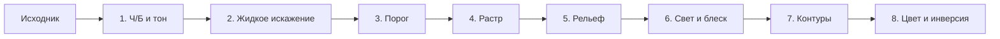
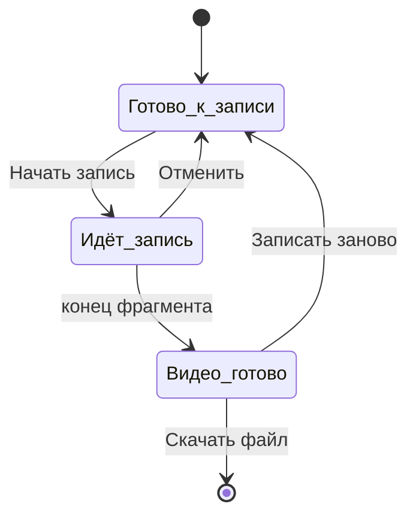

# ТЗ: Halftone Relief — браузерный инструмент

Sep 25, 2026 · @Алёна

## 1. Обзор продукта

Halftone Relief — браузерный инструмент, который превращает фото или видео в изображение с полутоновым растром, объёмным рельефом, хромовыми бликами и жидким искажением. Эффект может реагировать на звук. Рабочее название — заглушка.

**Основной сценарий.** Пользователь загружает фото или видео, и эффект сразу применяется со значениями по умолчанию, подобранными под образец. Затем пользователь при желании настраивает параметры слайдерами в живом превью, добавляет аудио и экспортирует результат.

**Принципы:**

- Все файлы обрабатываются только в браузере и никуда не отправляются. Сервер отдаёт только статический сайт.
- Живое превью: любое изменение параметра видно сразу, без кнопки «Применить».
- Минимум настроек: около десятка главных параметров, технические значения зашиты.
- Экспорт в исходном размере, без выбора масштаба.
- Десктоп, планшеты и телефоны (раздел 9); только тёмная тема, интерфейс на русском.

**Референс.** Обработанная картинка с собакой (приложена к проекту как `reference/sample.png`) — эталон вида эффекта по умолчанию.

## 2. Стек и архитектура

Эффект считается на GPU через WebGL2-шейдеры; интерфейс — лёгкий фронтенд без серверной части.

| Слой | Технология | Зачем |
| --- | --- | --- |
| Сборка | Vite + TypeScript | Быстрая разработка, статическая сборка в `dist/` |
| Интерфейс | Vanilla TS или Preact | Мало компонентов, важна скорость и малый вес |
| Эффект | WebGL2, фрагментные шейдеры GLSL, рендер в текстуры (многопроходный пайплайн) | 60 fps в превью |
| Видео на вход | `<video>` + `texImage2D` каждый кадр (`requestVideoFrameCallback`) | Кадр видео как текстура |
| Аудиоанализ | Web Audio API: `AnalyserNode` (FFT) | Уровни НЧ/СЧ/ВЧ и детектор кика |
| Запись видео | `canvas.captureStream()` + `MediaRecorder` | Запись в реальном времени, WebM/MP4 |
| Экспорт PNG | `canvas.toBlob()` из отдельного рендера в исходном размере | Полное разрешение независимо от превью |
| Экспорт SVG | Генерация `<circle>`/`<path>` из сетки растра и изолиний на CPU | Векторная геометрия |
| Хостинг | GitHub Pages (или Vercel/Netlify) | Бесплатный статический хостинг |

**Структура модулей:** `render/` (WebGL-контекст, шейдеры, проходы), `media/` (загрузка и проверка файлов, видео, таймлайн), `audio/` (анализ, реактивность), `export/` (PNG, SVG, запись видео), `ui/` (панель, слайдеры, палитра, экспорт), `state.ts` (единое состояние параметров).

**Состояние.** Все параметры хранятся в одном объекте состояния; UI и рендер подписаны на него. Значения по умолчанию лежат в одном файле `defaults.ts`. Настройки сохраняются в `localStorage`, файлы — нет.

## 3. Пайплайн эффекта

Пайплайн из восьми проходов, в этом порядке; искажение идёт до растра, чтобы сетка оставалась ровной, а «текло» изображение.



1. **Ч/Б и тон.** Перевод в яркость (Rec. 709). Контраст и гамма зашиты под образец. Альфа-канал: прозрачные пиксели считаются белыми.
2. **Жидкое искажение (domain warping).** UV смещаются по гладкому полю из двух-трёх октав simplex-шума, пропущенных через себя (warp от warp). «Сила» — амплитуда смещения в долях кадра, «Масштаб волн» — частота шума. Зерно шума (`seed`) случайное при загрузке, «Перемешать» даёт новое. Для видео поле медленно течёт во времени (сдвиг по третьей координате шума), чтобы кадры не дрожали.
3. **Порог.** Всё светлее порога уходит в чистый белый без текстуры. Край мягкий (smoothstep \~2% яркости), чтобы на границе точки исчезали постепенно, как на груди собаки в образце.
4. **Растр (halftone).** Регулярная сетка круглых точек, угол зашит (\~12°). Радиус точки растёт с темнотой. Соседние точки сливаются через smooth-min полей расстояния — отсюда лабиринтный узор в средних тонах. Результат — поле высот 0…1.
5. **Рельеф.** Поле высот размывается (Гаусс, радиус от «Объёма»), из него считаются нормали (центральные разности). «Объём» одновременно управляет высотой и мягкостью бугорков.
6. **Свет и блеск.** Направленный свет зафиксирован сверху-слева (азимут 315°, высота \~45°). Diffuse (Ламберт) + specular (Blinn-Phong). В самых светлых гладких зонах добавляется хромовый вид: резкий блик и тёмная окантовка по краю зоны. «Блеск» управляет силой specular и хрома вместе.
7. **Контуры.** Изолинии по размытой яркости: N равноотстоящих уровней, линии толщиной T px с антиалиасингом (через `fwidth`). Включаются переключателем.
8. **Цвет и инверсия.** Применяются к готовому результату (раздел 7). Инверсия — всегда последней.

Для экспорта PNG и SVG тот же пайплайн рендерится в исходном размере в отдельный фреймбуфер, а не копируется из превью.

## 4. Параметры

Пользователю доступны 10 слайдеров, кнопка «Перемешать» и переключатели; всё остальное зашито. Значения по умолчанию — стартовые, их нужно подобрать на этапе 1 так, чтобы результат совпадал с референсом.

| Раздел | Параметр | Диапазон | По умолчанию | Реактивность |
| --- | --- | --- | --- | --- |
| Искажение | Сила | 0–1 | 0.42 | да |
| Искажение | Масштаб волн | 0–1 | 0.60 | да |
| Искажение | Перемешать (кнопка) | новый `seed` | случайный | нет |
| Растр | Размер точки (шаг сетки) | 3–24 px | 9 px | да |
| Растр | Порог | 0–100 % | 78 % | да |
| Рельеф | Объём | 0–1 | 0.78 | да |
| Рельеф | Блеск | 0–1 | 0.70 | да |
| Контуры | Вкл/выкл | переключатель | вкл | нет |
| Контуры | Количество линий | 1–16 | 6 | да |
| Контуры | Толщина линий | 0.5–5 px | 1.5 px | да |
| Цвет | Интенсивность | 0–1 | 1.00 | да |
| Цвет | Инверсия | переключатель | выкл | нет |

**Зашитые значения** (константы в `defaults.ts`, в интерфейсе не показываются): угол сетки, форма точки (круг), сила слияния точек, контраст и гамма, направление света, мягкость края порога.

**Размер точки в пикселях исходника.** Шаг сетки задаётся в пикселях исходного файла, а не экрана, чтобы превью и экспорт выглядели одинаково.

**«Сбросить настройки»** возвращает все параметры к значениям по умолчанию, файлы не трогает. Без диалога; на 5 секунд показывается плашка «Настройки сброшены · Отменить».

## 5. Входные файлы и лимиты

Файл, не прошедший проверку, не загружается; пользователь видит сообщение с текущими параметрами, лимитом и что сделать.

| Тип | Форматы | Разрешение | Длительность | Вес |
| --- | --- | --- | --- | --- |
| Видео | MP4 (H.264), WebM, MOV (если браузер декодирует) | вписывается в 1920 × 1080 в любой ориентации | до 2 мин | до 500 МБ |
| Фото | PNG, JPG, WebP | до 4096 px по каждой стороне | — | до 50 МБ |
| Аудио | MP3, WAV, M4A, OGG | — | обрезается вместе с фрагментом | до 100 МБ |

**Длительность.** Видео длиннее 2 минут не отклоняется: оно открывается, а на таймлайне сразу выставлен фрагмент в первые 2 минуты.

**Видео с телефона.** Ролики, снятые в 4K, отклоняются по разрешению; в сообщении для них добавляется подсказка: «Снимите в 1080p или уменьшите видео». HEVC (MOV с iPhone) на iPhone и Mac открывается в Safari, на других системах — как в таблице сообщений ниже.

**Порядок проверки:** вес → метаданные (разрешение, длительность) → пробное декодирование первого кадра. Проверка до загрузки в WebGL.

**Тексты сообщений** (показываются на холсте, кнопка «Понятно»):

- Разрешение видео: «Видео 3840 × 2160 — больше допустимого. Максимум 1920 × 1080 (или 1080 × 1920). Уменьшите видео и загрузите снова.»
- Разрешение фото: «Фото 6000 × 4000 — больше допустимого. Максимум 4096 px по каждой стороне.»
- Вес: «Файл весит 820 МБ. Максимум для видео — 500 МБ.» (для фото 50 МБ, для аудио 100 МБ)
- Не декодируется: «Браузер не может открыть это видео. Часто так бывает с MOV (HEVC) с iPhone — перекодируйте его в MP4 (H.264).»
- Неподдерживаемый тип: «Этот формат не поддерживается. Загрузите фото (PNG, JPG, WebP) или видео (MP4, WebM).»

Числа в сообщениях подставляются из реального файла.

## 6. Аудио и аудиореактивность

Каждый слайдер с реактивностью можно привязать к одному из четырёх источников — НЧ, СЧ, ВЧ или Кик — и задать глубину.

**Источник звука.**

| Загружено | Эффект реагирует на | Раздел «Аудио» |
| --- | --- | --- |
| Фото или видео без звука, аудио нет | — (метки реактивности скрыты) | кнопка «Добавить аудио» + подсказка «Эффект начнёт реагировать на звук» |
| Видео со звуком, аудио нет | звук видео | строка «Реагирует на звук из видео» + «Добавить аудио» |
| Аудиофайл (с фото или видео без звука) | аудиофайл | волновая форма + крестик «Убрать» |
| Видео со звуком + аудиофайл | аудиофайл; при включённом чекбоксе — звук видео | волновая форма, крестик, чекбокс «Использовать звук из видео» (по умолчанию выкл) |

**Фото + аудио → видео.** Если к фото добавлено аудио, появляется таймлайн по длине трека (обрезка до 2 минут), а экспорт предлагает «Видео / PNG кадра».

**Анализ.** `AnalyserNode`, `fftSize` 2048, уровни считаются каждый кадр рендера.

| Источник | Полоса | Сглаживание |
| --- | --- | --- |
| НЧ | 20–250 Гц | плавное: атака \~30 мс, затухание \~250 мс |
| СЧ | 250–4000 Гц | плавное: атака \~30 мс, затухание \~250 мс |
| ВЧ | 4000–16000 Гц | плавное: атака \~20 мс, затухание \~200 мс |
| Кик | 40–120 Гц, детектор всплесков (spectral flux + адаптивный порог) | импульс: мгновенная атака, затухание \~180 мс |

Нормализации громкости нет: сила реакции зависит от громкости трека и регулируется глубиной. Значения атаки и затухания — константы, в интерфейсе их нет.

**Модуляция.** Итоговое значение = базовое значение слайдера + глубина × уровень источника (0…1), с ограничением в пределах диапазона. Глубина только положительная, 0…1 от диапазона параметра.

**Интерфейс реактивности.**

- Рядом со значением каждого слайдера — метка. Неактивна: серая иконка частот. Активна: белая плашка с источником («НЧ», «СЧ», «ВЧ», «КИК»).
- Клик по метке раскрывает под слайдером встроенное окно (соседние слайдеры сдвигаются вниз): кнопки НЧ / СЧ / ВЧ / КИК, слайдер «Глубина», кнопка «Отключить реакцию».
- На дорожке основного слайдера — полупрозрачная зона модуляции от базового значения до базового + глубина и «призрачный» ползунок с текущим значением в реальном времени.
- На паузе значения замирают на кадре, где остановились.
- В свёрнутом разделе с активной реактивностью в заголовке светится точка.

## 7. Цвет

Цвет применяется к готовому результату последним шагом пайплайна, инверсия — после цвета.

| Режим | Что делает | Контролы в разделе |
| --- | --- | --- |
| Ч/Б (по умолчанию) | Результат в оттенках серого | Инверсия |
| Тон → Сплошной | Цвет ложится поверх всего, как цветной фильтр: тонирует и тени, и света | Сплошной / Градиент, один кружок цвета, Интенсивность, Инверсия |
| Тон → Градиент | Градиентная карта: цвет «Тени» на тёмных, цвет «Света» на светлых | Сплошной / Градиент, кружки «Тени» и «Света», полоса-превью, «поменять местами», Интенсивность, Инверсия |
| Исходные | Цвета оригинала проступают сквозь растр и рельеф, блики остаются хромовыми | Интенсивность (как насыщенность), Инверсия |

Ненужные в режиме контролы скрываются, а не становятся неактивными.

**Интенсивность** — смешивание с ч/б результатом от 0 (без цвета) до 1 (полное тонирование).

**Инверсия** — `1 − rgb` уже окрашенного результата. Состояние сохраняется при переключении режимов.

**По умолчанию:** градиент от #000000 к #FFFFFF, сплошной цвет #FFFFFF, режим «Ч/Б».

**HSB-палитра** — своя, в стиле интерфейса, открывается встроенно под кружком цвета: квадрат насыщенности (по горизонтали) и яркости (по вертикали) для текущего оттенка, под ним полоса оттенков 0–360°, ниже образец цвета и поле HEX (ввод и копирование). Полей RGB нет. Закрывается кликом вне палитры или по кружку.

## 8. Экспорт

Экспорт всегда в исходном размере файла; видео записывается в реальном времени через `MediaRecorder`.

| Что загружено | Варианты экспорта | Формат |
| --- | --- | --- |
| Фото | PNG или SVG | PNG — полный эффект; SVG — точки растра и контуры, без объёма и бликов, цвет по текущему режиму |
| Видео | Видео или PNG кадра | MP4 / WebM; PNG — текущий кадр на таймлайне |
| Фото + аудио | Видео или PNG кадра | Видео в размере фото, но не больше 1920 × 1080 (уменьшается с сохранением пропорций); PNG — в полном размере фото |

**Формат видео.** При открытии панели проверяется `MediaRecorder.isTypeSupported()`. По умолчанию MP4 (H.264 + AAC), если поддерживается, иначе WebM (VP9 или VP8 + Opus). Неподдерживаемый вариант показывается неактивным с подсказкой «Ваш браузер не умеет записывать MP4 — используйте WebM или Chrome/Safari». Частота кадров записи — 30 fps, битрейт видео \~12 Мбит/с.

**Звук в видео** — выбор из трёх: «Из аудиофайла» (только если он загружен), «Из видео», «Без звука». По умолчанию повторяет выбор в разделе «Аудио», но меняется независимо от реактивности.

**Фрагмент** — только отображается («0:08 – 1:18»), задаётся ручками на таймлайне.

**Состояния панели экспорта видео:**



1. **Готово к записи:** все поля активны, подсказка «Видео сохранится в исходном размере. Запись идёт в реальном времени и займёт M:SS — не закрывайте вкладку.», кнопка «Начать запись».
2. **Идёт запись:** поля неактивны; индикатор «Идёт запись», время «0:38 / 1:10», прогресс, текст «Не закрывайте и не сворачивайте вкладку, иначе запись прервётся.», кнопка «Отменить». Видео проигрывается с начала фрагмента, на превью метка REC. Если вкладка ушла в фон — запись прерывается с сообщением.
3. **Видео готово:** «Видео готово», сводка «MP4 · 1:10 · звук из аудиофайла», кнопки «Скачать файл» и «Записать заново». Автоматического скачивания нет.

**Экспорт фото:** формат PNG / SVG, пояснение про SVG, кнопка «Скачать». Файл готов сразу.

**Панель экспорта** выдвигается на месте панели настроек по кнопке «Экспорт» в шапке и закрывается крестиком. Пока она открыта, настройки недоступны. Имя файла: `halftone-relief-YYYYMMDD-HHMM.<ext>`.

**Экспорт на телефоне:**

- Панель экспорта открывается на весь экран.
- «Скачать» / «Скачать файл» вызывает системное меню «Поделиться» (Web Share API с файлом), чтобы файл можно было сохранить в галерею или отправить. Если Web Share недоступен — обычное скачивание.
- Во время записи текст: «Не блокируйте экран и не сворачивайте браузер, иначе запись прервётся». Экран не гаснет во время записи (Screen Wake Lock API, где поддерживается).
- Если телефон не успевает рендерить эффект в исходном размере в реальном времени (падение ниже 24 fps в первые 2 секунды), запись останавливается с сообщением: «Телефону не хватает мощности для записи этого видео. Попробуйте более короткий или меньший ролик или запишите на компьютере».

## 9. Интерфейс

Эталон вида — макеты v5 на [холсте дизайна](https://claude.ai/artifact/SwZM5uP6Rc8cQt84V2qDp7) (экраны «v5 — …»); при расхождении с текстом прав текст ТЗ. Мобильных макетов пока нет — мобильная раскладка описана ниже текстом.

**Десктопная раскладка (от 1024 px, включая планшеты в альбомной ориентации):**

- **Шапка 60 px:** логотип HALFTONE/RELIEF слева; справа «Загрузить фото или видео», «Сбросить настройки», разделитель, хромовая кнопка «Экспорт» (неактивна без файла). Данных о файле в шапке нет.
- **Холст:** превью в пропорциях исходника, вписано в свободную область, без зума и панорамирования. Для видео и фото + аудио под превью таймлайн: пауза/воспроизведение, текущее время, дорожка с ручками начала и конца фрагмента и ползунком, длительность.
- **Панель настроек справа, 320 px:** разделы Аудио, Искажение, Растр, Рельеф, Контуры, Цвет. Каждый сворачивается стрелкой; в свёрнутом виде в заголовке сводка значений моноширинным шрифтом. Состояние сворачивания хранится в `localStorage`. При переполнении панель прокручивается.
- **Панель экспорта:** на месте панели настроек, той же ширины.

**Пустое состояние:** на месте холста зона перетаскивания с пунктирной рамкой и полутоновым рельефом, подсвеченным вокруг курсора (круг \~190 px, следует за мышью). В центре: иконка, «Перетащите фото или видео», кнопка «Выбрать файл», лимиты («Видео — до 1920 × 1080, 2 мин, 500 МБ», «Фото — до 4096 × 4096, 50 МБ»), строка с замком «Файлы обрабатываются в браузере и никуда не загружаются». Панель настроек выглядит как обычно, её значения применятся к файлу. Перетаскивание работает на всё окно.

**Мобильная раскладка (до 1024 px — телефоны и планшеты в портретной ориентации):**

- **Шапка 52 px:** логотип слева; справа иконка «Загрузить», меню «⋯» (в нём «Сбросить настройки») и хромовая кнопка «Экспорт».
- **Холст** — сверху на всю ширину экрана, в пропорциях исходника; под ним таймлайн, если есть видео или аудио.
- **Настройки — нижняя шторка** с ручкой, три положения: свёрнута (видна только строка заголовков разделов), половина экрана, весь экран. Перетаскивание ручки и тап по ней. Внутри те же сворачиваемые разделы, что на десктопе. Превью остаётся видно при шторке на половине экрана.
- **Панель экспорта** — полноэкранная шторка поверх всего, закрывается крестиком или свайпом вниз.
- **Касания:** все интерактивные элементы не меньше 44 × 44 px; ползунок слайдера 24 px; значение слайдера меняется только при горизонтальном движении, вертикальный свайп прокручивает шторку.
- **HSB-палитра и окно реактивности** — встроенно, на всю ширину шторки.
- **Пустое состояние:** текст «Выберите фото или видео» вместо «Перетащите», вся зона — кнопка выбора файла; подсветка рельефа медленно движется сама и следует за пальцем при касании.
- **Поворот экрана** перестраивает раскладку без потери состояния; воспроизведение и запись при этом не прерываются.

**Производительность на телефоне.** Превью рендерится в пониженном разрешении (длинная сторона до 1080 px, при падении ниже 30 fps — до 720 px), экспорт — всегда в исходном размере. Для iOS: `AudioContext` запускается только после касания пользователя (первое нажатие на воспроизведение).

**Визуальный стиль:**

| Элемент | Значение |
| --- | --- |
| Фон приложения / панели | #0A0A0B / #0D0D0E, разделители #1C1C20 |
| Текст основной / вторичный / приглушённый | #EDEDF0 / #A8A8B0 / #8C8C95 |
| Шрифты | Unbounded (логотип, заголовки разделов капсом, 10 px, трекинг 0.16em), Onest (текст), JetBrains Mono (значения) — Google Fonts |
| Дорожка слайдера | 10 px, полутоновые точки: пустая часть — мелкие тёмные, заполненная — крупные светлые (шаг 6 px) |
| Ползунок | хромовый шарик 16 px (радиальный градиент с бликом) |
| Кнопка «Экспорт» и главные действия | хромовая «пилюля» с бликом, тёмный текст |
| Акцент | нет цветного акцента, интерфейс монохромный; красный #FF4D4D только для индикатора записи |

Все контролы доступны с клавиатуры, у слайдеров — нативные `input[type=range]` под визуальным слоем, у иконок — `aria-label`.

## 10. Этапы разработки

Пять этапов; каждый заканчивается рабочей версией, которую проверяют руками, прежде чем идти дальше.

| Этап | Что входит | Готово, когда |
| --- | --- | --- |
| 1. Фото и эффект | Загрузка фото с проверкой лимитов, весь пайплайн (раздел 3), панель: Искажение, Растр, Рельеф, Контуры, сворачивание, «Сбросить настройки», экспорт PNG, пустое состояние | Референс воспроизводится со значениями по умолчанию; превью 60 fps на фото 4096 px; PNG совпадает с превью |
| 2. Видео | Загрузка видео, таймлайн с обрезкой, течение искажения во времени, панель экспорта со всеми состояниями, MP4/WebM, PNG кадра | Ролик 1080p / 2 мин записывается без пропуска кадров в Chrome и Safari; кадры не дрожат |
| 3. Аудио | Раздел «Аудио» во всех состояниях, анализ НЧ/СЧ/ВЧ/Кик, метки и окно реактивности, зона модуляции, выбор звука в экспорте, фото + аудио → видео | Кик срабатывает на бочку и не срабатывает на бас; звук в файле синхронен с картинкой |
| 4. Цвет и доводка | Раздел «Цвет» с HSB-палитрой, экспорт SVG, все сообщения об ошибках, плашка «Отменить», доступность с клавиатуры | Все экраны совпадают с макетами v5; SVG открывается в Figma и Illustrator |
| 5. Мобильная версия | Мобильная раскладка и шторки (раздел 9), касания, пониженное разрешение превью, экспорт через «Поделиться», Wake Lock, проверка мощности при записи | Все сценарии этапов 1–4 проходят на iPhone (Safari) и Android (Chrome); превью не ниже 30 fps; файл сохраняется в галерею |

**Браузеры:** последние версии Chrome, Edge, Safari и Firefox на десктопе; Safari на iOS/iPadOS 17 и новее, Chrome на Android 12 и новее. Раскладку делать адаптивной с этапа 1, чтобы этап 5 был доводкой, а не переделкой.

## 11. Claude Code и публикация на GitHub

ТЗ кладётся в репозиторий как `SPEC.md`, и Claude Code собирает инструмент по этапам из раздела 10.

**Подготовка проекта:**

1. Создайте пустую папку `halftone-relief`.
2. Экспортируйте этот документ в Markdown и сохраните как `SPEC.md` в корне папки.
3. Создайте папку `reference/` и положите туда `sample.png` (картинку с собакой) и, если есть, исходное фото до обработки, а также 2–3 тестовых файла (короткое видео, трек, фото с телефона).
4. Откройте папку в Claude Code.

**Первый запрос в Claude Code:**

```markdown
Прочитай SPEC.md — это ТЗ проекта. Создай CLAUDE.md с кратким описанием проекта, стека и правил (ссылка на SPEC.md как источник истины). Затем выполни только этап 1 из раздела 10: инициализируй проект на Vite + TypeScript, реализуй пайплайн эффекта на WebGL2 и интерфейс этапа 1. Подбери значения по умолчанию так, чтобы reference/sample.png воспроизводился как можно ближе. Запусти dev-сервер и скажи, как проверить.
```

**Дальше по этапам:** после проверки этапа попросите «Этап 1 принят, выполни этап 2 по SPEC.md», и так до этапа 5. Замечания давайте конкретно: файл, значения слайдеров, что видно и что ожидалось.

**Публикация на GitHub Pages:**

1. Создайте на GitHub пустой репозиторий `halftone-relief`.
2. Попросите Claude Code: «Подключи репозиторий `https://github.com/<логин>/halftone-relief`, сделай первый коммит и push. Настрой деплой на GitHub Pages через GitHub Actions и выставь `base` в vite.config под имя репозитория».
3. В настройках репозитория: Settings → Pages → Source: GitHub Actions.
4. После push сайт появится по адресу `https://<логин>.github.io/halftone-relief/`. Каждый следующий push в `main` обновляет его автоматически.

Секретов и ключей у проекта нет: сервер не нужен, все вычисления в браузере.
